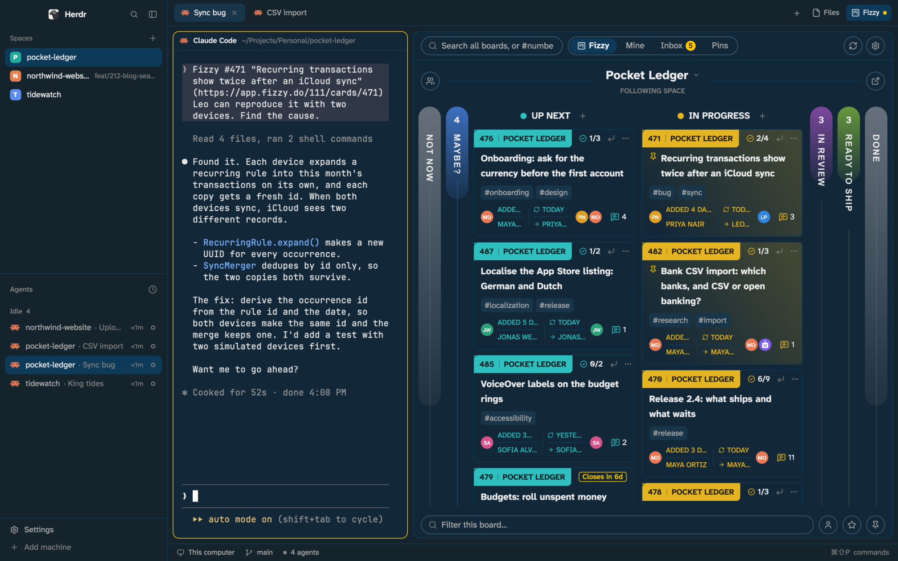
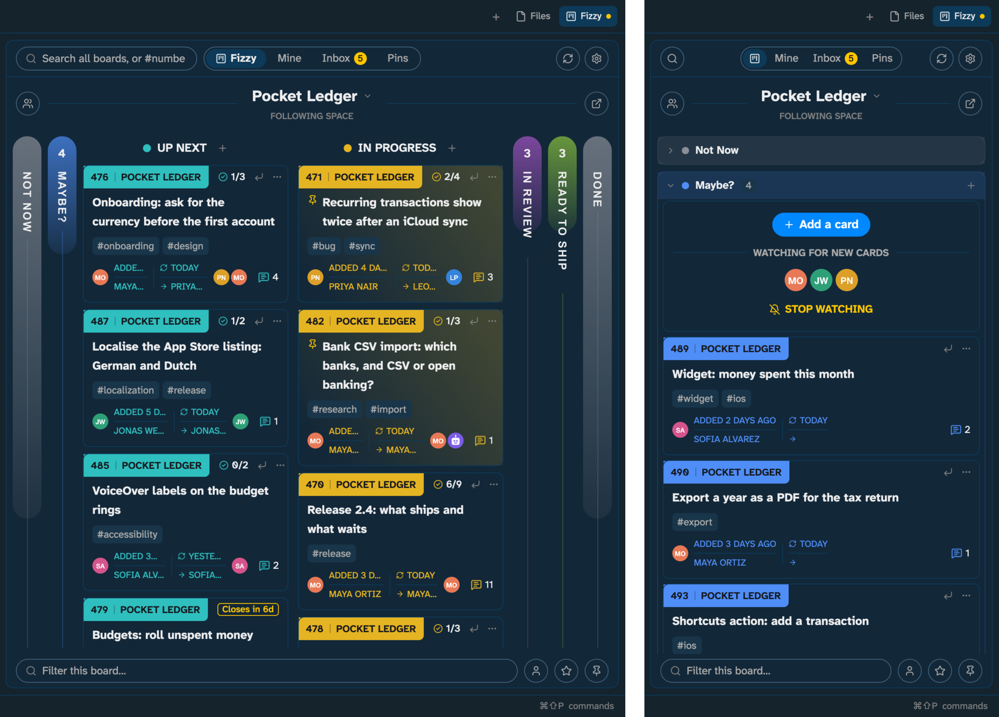
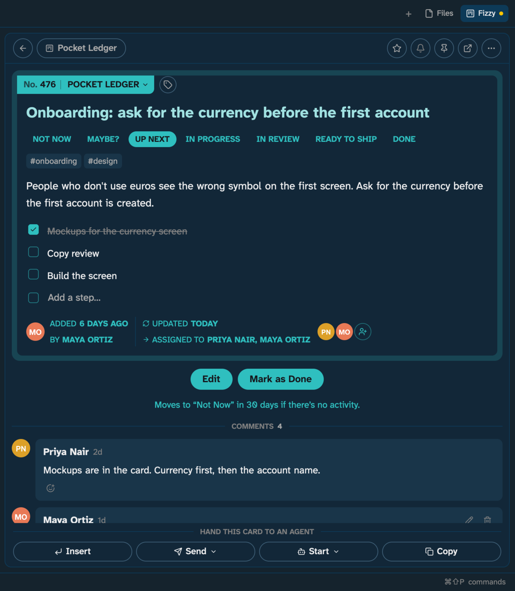
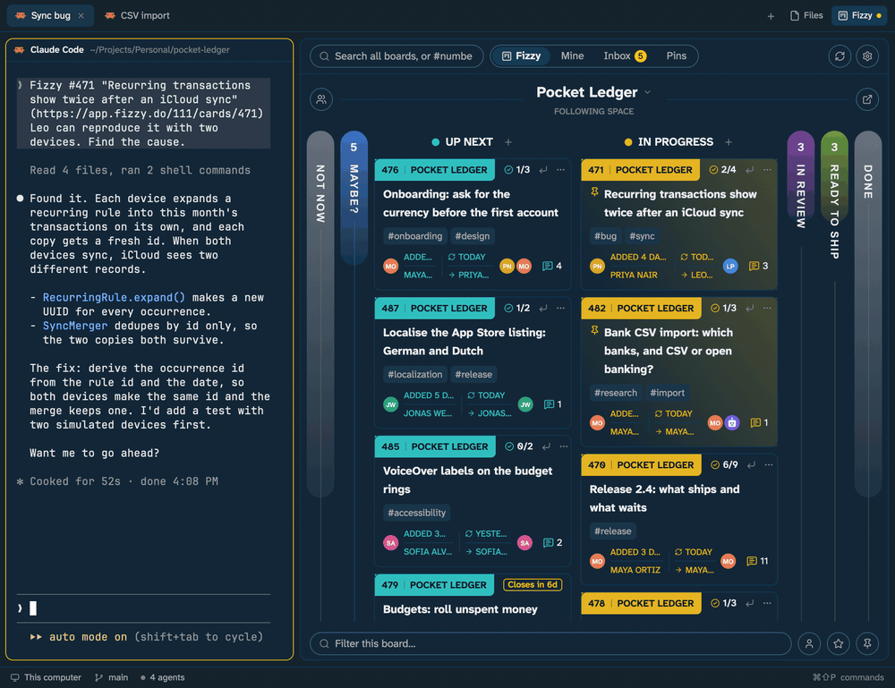
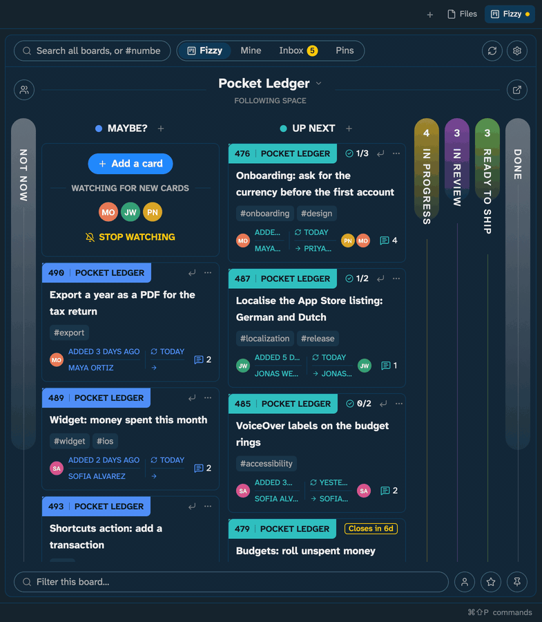
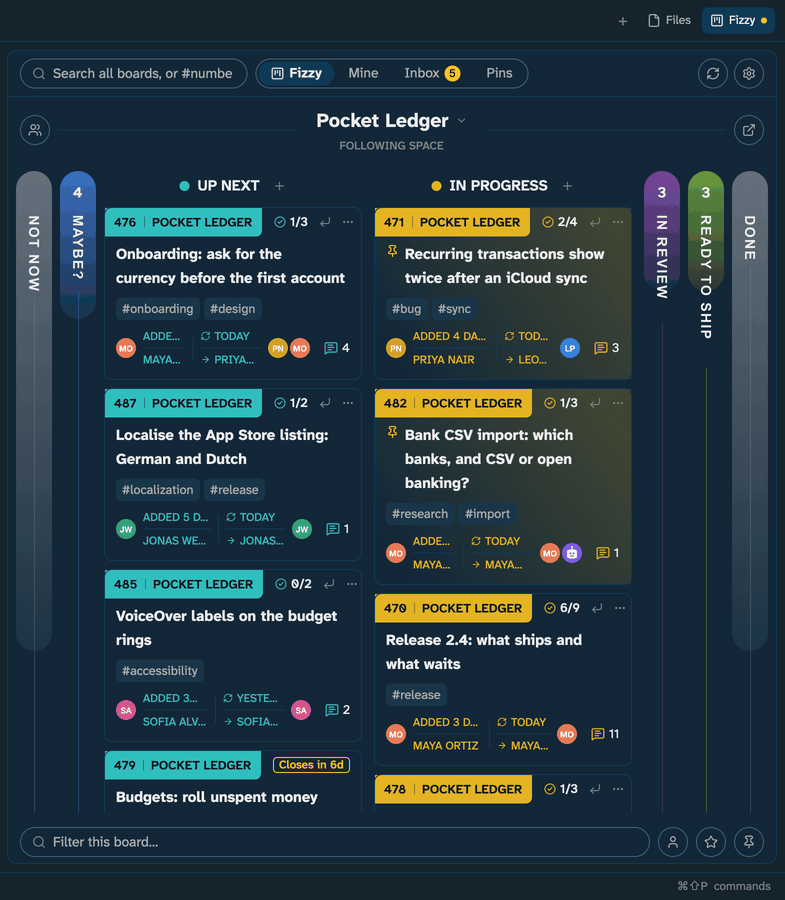
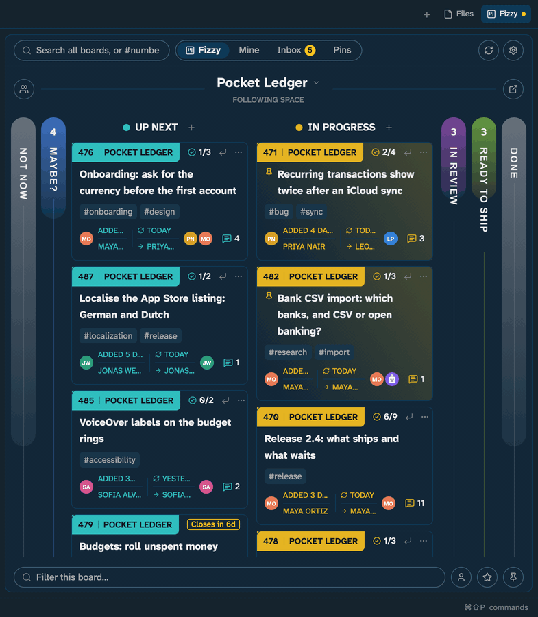
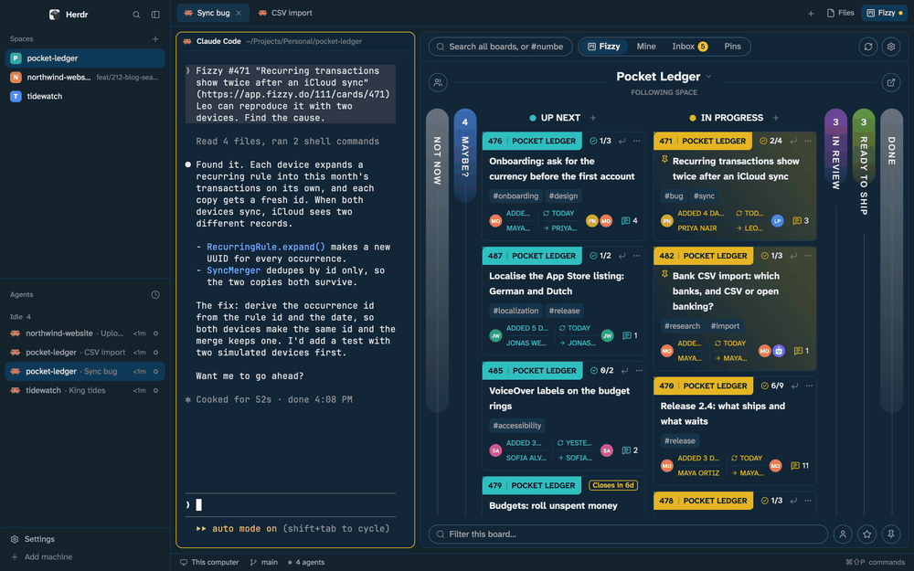
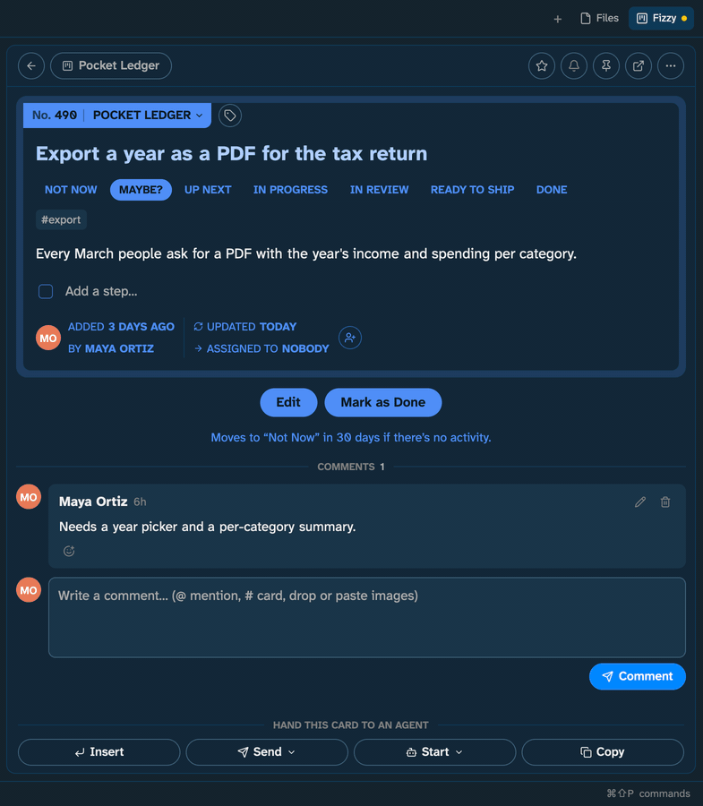
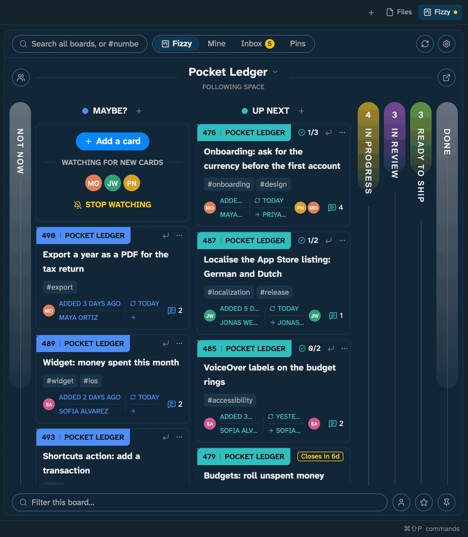

# Fizzy for Herdr

Your Fizzy boards, cards and notifications in Herdr's side panel, right next to your terminals and coding agents.



_The screenshots and GIFs come from a demo account: the boards, people and chats in them are made up._

## Sponsor

<a href="https://thewildmagic.com">
  <picture>
    <source media="(prefers-color-scheme: dark)" srcset="docs/media/wildmagic-dark.svg">
    
  </picture>
</a>

[Wildmagic](https://thewildmagic.com) sponsors this project.

## What it is

Fizzy for Herdr is a mod that adds a **Fizzy** page to Herdr's right side panel, next to Files and Changes. It puts your
boards, cards and notifications beside your terminals and agents, so you can read and change cards without leaving
Herdr. Everything goes through the `fizzy` CLI you already use. You can also hand a card to a coding agent running in
Herdr. Nothing is ever sent for you: the card's reference lands in the agent's input box, and you press Enter.

This page is the short version. [docs/REFERENCE.md](docs/REFERENCE.md) has every detail.

## Features

### A board like Fizzy's

On a panel 480 px wide or more, the lanes stand side by side in the board's own order. One or two are open; the others
fold into narrow pills in the lane's color, with their card count. On a narrower panel the lanes stack, each a block
with a tinted header, and Not Now and Done start folded.



### Four views

**Board**, **Mine** (the cards assigned to you on every board), **Inbox** (your unread notifications) and **Pins** sit
in one group in the panel's header. Click one to switch.


### Open and change a card

Click a card to open it, as in Fizzy. Rename it, move it to another lane or board, tick and add steps, edit the
description (images and files show in place), write comments and react to them, assign people, add tags, make it golden,
pin it, watch it and mark it Done.



### Hand a card to an agent

The bar at the foot has four buttons. **Insert** pastes the card's reference into the agent you are talking to, **Send**
into a running session you pick, **Start** into a new tab with an agent you choose, and **Copy** puts it on the
clipboard. The reference is one line, `Fizzy #42 "Fix the login redirect" (<link>)`, or just `Fizzy card #42` with
**Settings > Cards > Short references** on. You add what you want to say and press Enter yourself.



### Move cards

Pick a lane from a card's menu (`⋯` or a right-click), click a lane on the card's page, or drag the card onto another
lane. Drag a card onto a terminal to drop it there as a markdown file: Herdr types the file's path, without Enter.
Drag a column's header onto another to reorder the columns. ⌘-click or Ctrl-click picks several cards, to hand them
over or drag them into a terminal together.



### Search every board

The search has its own key, cmd-shift-k (Linux: ctrl-shift-s); you can also click the field in the header. Type and
press Enter: the results come in a section per board, from open, Not Now and closed cards and from comments. A card's
number with its `#`, such as `#42`, opens that card from any board. A number without the `#` is searched for, and
when only one card is found, that card opens.



### Notifications

Every 30 seconds, also while the panel is hidden, the panel checks your unread notifications. Each new one pops up as a
Herdr toast (at most three per check, then "N more in Fizzy"). Click a toast to open its card. The Fizzy button on the
tab bar shows a dot while you have unread notifications.



### Follow the current space

Put a `.fizzy.yaml` with a `board:` line in a project. When you switch to that project's space, the panel shows that
board. Without one, it shows the board you picked, then the `fizzy` CLI's default board, then your first board.



### Mentions and card links

In a description or comment, type `@` for a picker of people and `#` for a picker of cards. Saved, a person becomes a
real Fizzy mention that notifies them, and a card becomes a link that opens in the panel.



### New card

Click **Add a card** or the **+** beside a lane's name, or bind `fizzy.new` to a key and pick a board. The panel makes
the card at once and opens it with an empty title field: type the title, press Enter, and add steps. **Done** goes back
to the board; **Discard** deletes the card again.



### And more

- **Filter.** The filter at the foot narrows the list as you type. On Board, **My cards**, **Golden cards** and
  **Pinned cards** buttons narrow it further.
- **Board groups.** Group your boards in **Settings > Board groups**, by hand or by a rule on the name, and hide the
  ones you never use.
- **Compact cards.** **Settings > Cards** draws each card in three short lines, so more fit on screen
  ([see it](docs/media/compact.png)).
- **Images and paste.** Images show in place; click one to open it, or drag it into a terminal to drop its file. Drop a
  file on a description or comment box, or paste an image, to attach it.
- **Photos.** People show with their Fizzy profile photo, or their initials.
- **Board access.** See who can see a board, switch **Everyone on the team**, and watch a board for new cards.

## Install

You need:

- Herdr 0.1.16 or newer.
- macOS or Linux. It is tested on macOS; Linux is untested.
- The `fizzy` CLI, version 4 or newer, signed in with `fizzy setup`
  (`brew tap basecamp/tap && brew install --cask basecamp/tap/fizzy`).
- `bash`, `jq`, `patch`, `diff` and `cmp` for `install.sh`. `curl` for photos and web images (without it, initials).
- Node.js, optional: only `--add-key` and `--uninstall` use it, to edit `keys.json`.

```sh
git clone https://github.com/demirelio/herdr-fizzy.git && cd herdr-fizzy
./install.sh               # install the mod, the tab bar with the Fizzy button and the fizzy-core layout
./install.sh --add-key     # the same, and bind the two keys in keys.json
./install.sh --uninstall   # take it all out again
                           # add --dry-run to any of them to see what would change, changing nothing
```

In Herdr's app folder (`~/.config/herdr-app`) it puts `mods/fizzy`, the panel; `mods/fizzy-tabs`, Herdr's own tab bar
plus a Fizzy button after Files and Changes; and `layouts/fizzy-core.json`, Herdr's `main` layout with the Fizzy page
added to the right panel. The panel stays hidden and Files stays in front until you pick Fizzy. When Herdr is running
and shows `main`, the script switches it to `fizzy-core`. Herdr reloads mods, layouts and `keys.json` as their files
change, so there is nothing to restart.

Keys are not added by default. Since Herdr 0.1.13, a `keys.json` nobody has edited gets Herdr's new default shortcuts
when Herdr updates, and any edit makes the whole file yours, which stops that. So the script prints the lines to add;
`--add-key` adds them for you, each only if its key is free.

[docs/REFERENCE.md](docs/REFERENCE.md#install) has the flags, the exit codes and what a re-run does.
[tabs/README.md](tabs/README.md) and [layout/README.md](layout/README.md) set Fizzy up in your own tab bar and layout.

## How it works

- **Everything goes through the `fizzy` CLI.** Each read and each change is a `fizzy` command with `--json`, for the
  account the CLI is signed in to. The mod makes no network requests of its own; `curl` fetches profile photos and web
  images, and nothing else.
- **It polls.** While the panel is shown it reads what is on screen every 30 seconds. Unread notifications are read
  every 30 seconds even while the panel is hidden, which feeds the toasts, the Inbox count and the tab bar's dot.
- **It caches.** A copy of each board you opened, and the step and comment counts of your last 400 cards, are kept in
  Herdr's local storage, so the panel shows at once on the next start.
- **It finds the board from `.fizzy.yaml`.** The panel looks for the nearest one in or above the active space's folder
  (on that space's machine, for a remote space) and keeps only its `board:` line.
- **Hand-offs use the clipboard.** The reference goes on the clipboard for a moment, is pasted into the agent, and the
  text you had there is put back.
- **The tab bar is Herdr's own plus a patch.** `fizzy-tabs` adds the Fizzy button and its dot, which reads the shared
  value `fizzy.unread`. Other mods can read it too.
- **The panel takes key commands.** Bind `"<key>": "fizzy.<command>"` in `keys.json`.

## Keys

`--add-key` binds these two to the `fizzy-tabs` tab bar, which `fizzy-core` uses. On Linux, Herdr's own `ctrl-shift-k`
opens its mod picker, which is why the search key differs.

| Key (macOS / Linux) | What it does |
|---|---|
| `cmd-shift-j` / `ctrl-shift-j` | Opens the Fizzy page, or hides the panel when Fizzy is already in front |
| `cmd-shift-k` / `ctrl-shift-s` | Opens the Fizzy page with the search of every board focused |

The panel takes commands of its own. Bind `"<key>": "fizzy.<command>"` in the `global` section of `keys.json`, for
example `{ "global": { "<your key>": "fizzy.insert" } }`:

| Command | What it does |
|---|---|
| `fizzy.new` | Picks a board and makes a card in its Maybe? |
| `fizzy.search`, `fizzy.filter` | Puts the cursor in the search field, or in the filter at the foot |
| `fizzy.view:<board\|mine\|inbox\|pins>` | Shows that view |
| `fizzy.open:<number>` | Opens that card |
| `fizzy.insert`, `fizzy.send`, `fizzy.start`, `fizzy.copy` | The hand-off buttons, for the open or picked cards |
| `fizzy.board:<id or name>`, `fizzy.follow` | Picks a board, or follows the current space again |
| `fizzy.refresh`, `fizzy.back` | Reads again, or steps back out of a card, Settings or the search |

[docs/REFERENCE.md](docs/REFERENCE.md#keys) has the full table.

## Quirks and limitations

- **Fizzy has no drafts.** **New card** makes the card on the board at once, titled "New card", and **Discard**
  deletes it again. A title you never save leaves the card as "New card".
- **Mentions need a mention id.** No Fizzy command lists them, so the panel learns them from mentions already in Fizzy.
  Until it knows someone's, the picker says "can't tag yet" and saving keeps "@Name" as plain text (a toast says they
  were not notified). **Settings > Mentions** shows who is missing and helps it learn.
- **Search is rationed.** Fizzy answers with its 15 newest matches and allows 300 searches an hour per person, shared
  with anything else of yours that searches. So the panel searches only on Enter, never as you type, and never tries
  again by itself. The filter at the foot only sees cards the panel has already read.
- **The watch bell starts dim.** Fizzy doesn't say whether you watch a card, so the bell stays dim until you set it from
  the panel. The panel remembers that for your last 200 cards.
- **Some changes stay in Fizzy.** Adding or removing one person's access to a board, reactions on the card itself, and
  making or changing boards and columns (beyond a column's place) are done in Fizzy, one click away with Open in Fizzy.
- **A big board costs calls the first time.** Fizzy's card lists carry no step or comment counts, so the first view
  makes two CLI calls per card. They are kept, and a card is read again only once it has changed. Not Now and Done are
  read when you open them, so a folded one shows no count until then.
- **Editing text is lossy.** A description edited as text keeps line breaks, bullet lists, mentions, card links and
  files; a numbered list comes back bulleted, other formatting is lost on save, and the editor warns you. Steps are
  plain text: no `@` or `#` picker, no files.
- **`fizzy.*` keys only work while the Fizzy page is shown.** Herdr gives them to a shown panel only. The two install
  keys also need the `fizzy-tabs` tab bar; in other layouts they do nothing.
- **Fizzy lives in `fizzy-core`, not in Herdr's own `main`.** Herdr puts its own layouts back on every start, so the
  script makes a layout of its own. With a layout of yours, add the page by hand ([layout/README.md](layout/README.md)).
- **The tab-bar patch may not fit a future Herdr.** The script builds `fizzy-tabs` only when every hunk fits. If not,
  the mod still goes in, the run exits 2, and you apply the patch by hand ([tabs/README.md](tabs/README.md)).
- **Linux is untested.** It is built for Linux but only tested on macOS.
- **Uninstall leaves some files.** Downloaded photos and images stay in `data/fizzy` in Herdr's app folder, and the
  panel's storage and Herdr's own `fizzy.*` records stay too. Delete `data/fizzy` yourself to remove the files.

## Privacy

- It runs `fizzy` on your computer, always with `--json`, and a few short `sh` scripts for profile photos and web images
  (`curl`), the `.fizzy.yaml` lookup, and opening, saving and pasting files. Nothing reaches Fizzy except through the
  `fizzy` CLI.
- It keeps profile photos and images in `data/fizzy` in Herdr's app folder, and in Herdr's local storage a copy of each
  board you opened (descriptions cut to 300 characters), your view and choices, and the mention ids it learned. Those
  ids stay on your computer and only go back to Fizzy inside a comment or description you save.
- It never reads your token. It opens none of the CLI's own files, asks `fizzy config show` for two values only, and
  keeps only the `board:` line of a `.fizzy.yaml`, never the rest.

[docs/REFERENCE.md](docs/REFERENCE.md#what-it-runs-reads-and-stores) lists every command, file and stored value.

## Development

```sh
npm test                                                          # the whole suite (node 22 or newer)
node --import ./test/register.mjs --test test/fizzy-lib.test.mjs  # one file
```

The tests never start Herdr or run a real `fizzy`. [docs/REFERENCE.md](docs/REFERENCE.md#development) has what each
test file covers, and [RECIPE.md](RECIPE.md) is the brief to build the panel from scratch; with `preview.png`, it is
what a mod shared on herdr.dev/mods carries.

## License

MIT: see [LICENSE](LICENSE). The icons are Lucide's, and the patch's context lines are Herdr's:
[THIRD_PARTY_NOTICES.md](THIRD_PARTY_NOTICES.md) has their licenses.
